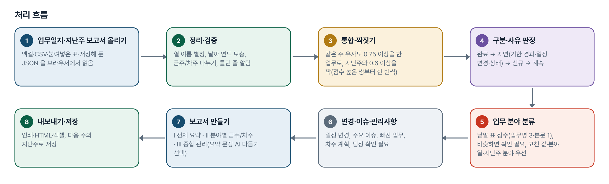
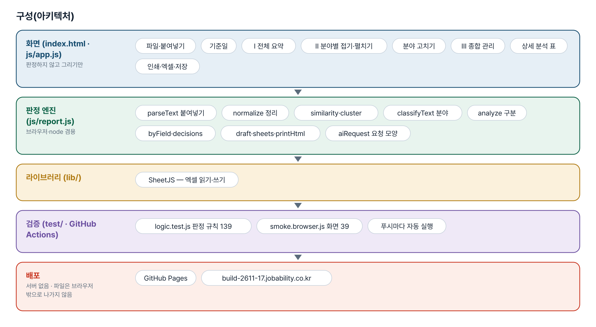
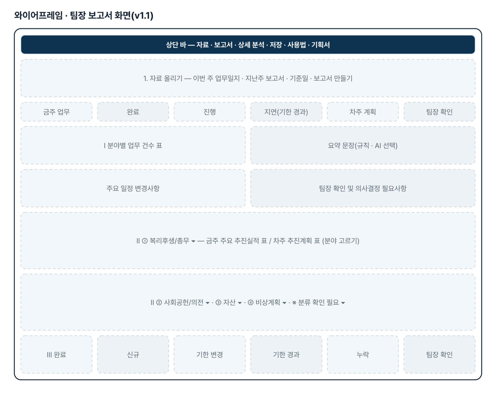
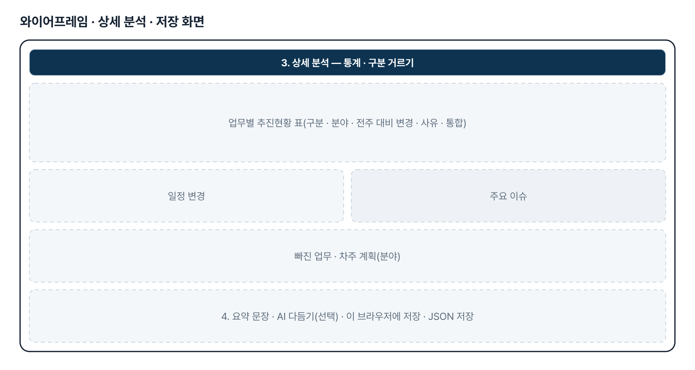
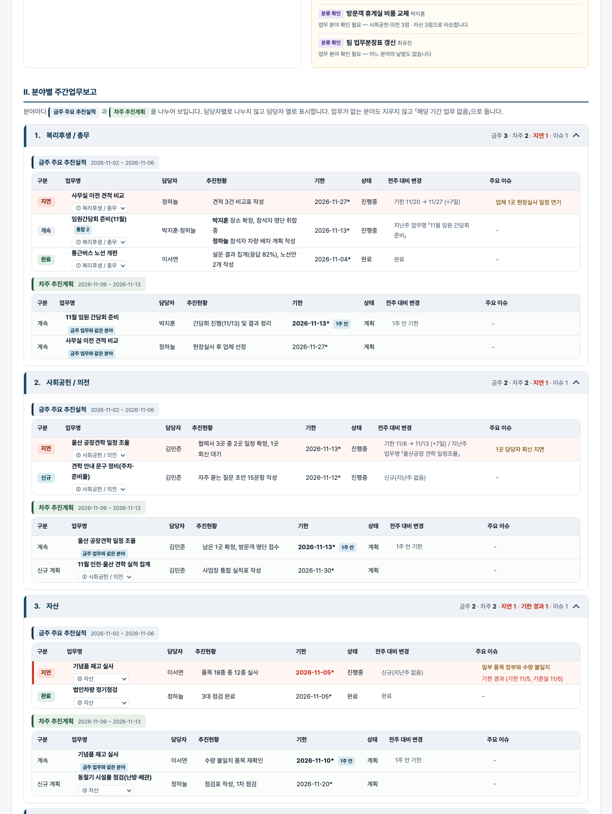

# 주간업무보고 자동 생성 — 프로젝트 기획서 v1.1

- 기획: 김수준 · 작성일 2026-11-03 · 생성형 AI 업무자동화 전문가과정 · 2차수 프로젝트 17
- 바로 쓰기: https://build-2611-17.jobability.co.kr/
- 워드 판: `docs/기획서/build-2611-17_김수준_주간업무보고자동생성_기획서_v1.1.docx`

## 개요

팀원별 금주·차주 업무일지와 지난주 주간업무보고서를 올리면 업무마다 지난주와 비교해 신규·계속·완료·지연을 나누고, 비슷한 업무를 통합하고, 복리후생/총무 · 사회공헌/의전 · 자산 · 비상계획 4개 업무 분야로 자동 분류해 전체 요약 → 분야별 금주 실적·차주 계획 → 종합 관리사항 순서의 팀장 보고용 주간업무보고서를 만드는 도구입니다.

### 배경 · 현재 업무
- 팀원별 금주·차주 업무일지와 지난주 주간업무보고서를 하나씩 열어 확인하고 취합합니다.
- 업무별 추진현황·변경사항·일정·주요 이슈를 지난주와 비교해 보고서로 쓰는 데 시간이 걸립니다.
- 같은 업무를 팀원마다 다른 이름으로 적어 중복과 누락을 가려내기 어렵습니다.
- 보고서 형식과 판단 기준이 작성자마다 달라 보고가 일정하지 않습니다.
- (v1.1) 팀원별로 업무가 나열되어 팀장이 어떤 분야의 업무가 어떻게 진행되는지 한눈에 보기 어렵습니다.

### 목표
- 엑셀·붙여넣은 표를 그대로 올려 팀원별 업무일지를 한 번에 취합합니다.
- 지난주 보고서와 비교해 신규·계속·완료·지연을 규칙으로 구분하고 지연 사유를 적습니다.
- 비슷한 업무명을 하나로 묶고 일정 변경·주요 이슈·빠진 업무를 모읍니다.
- 팀장 보고용 초안을 인쇄·HTML·엑셀로 내고, 이번 주 결과를 다음 주의 지난주로 저장합니다.
- (v1.1) 보고서의 최상위 분류를 팀원에서 업무 분야 4개(고정 순서)로 바꾸고, 분야마다 금주 실적과 차주 계획을 나누어 보입니다.

## 요구사항과 구현

| 기획서 요구 | 구현 |
|---|---|
| 팀원별 업무일지 자동 취합 | 엑셀 여러 파일·여러 시트·붙여넣은 표(탭·마크다운·CSV), 팀원 열이 없으면 파일·시트 이름에서 짐작 |
| 지난주 보고서와 비교해 변경사항 자동 추출 | 업무명 정규화 + 글자쌍 유사도로 지난주 업무와 짝짓기 |
| 업무별 추진현황·일정·주요 이슈 분석 | 업무별 표 · 일정 변경 목록(지난주 대비 / 차주 계획 대비) · 이슈 모음 |
| 지연·완료·신규 업무 구분 | 규칙 판정 4종(완료·지연·신규·계속), 지연은 사유(기한 경과·일정 변경 +n일·상태) 표시 |
| 중복 업무 통합 | 같은 주 유사도 0.75 이상이면 팀원이 달라도 한 줄로, 「통합」 표시 |
| 핵심 추진사항 요약 | 규칙 요약 문장(숫자는 데이터에서 셈), AI 다듬기는 선택 |
| 팀장 보고용 초안 자동 생성 | 인쇄(A4) · 인쇄용 HTML · 엑셀 7시트 |
| (추가) 다음 주로 이어 쓰기 | 이번 주 결과를 localStorage·JSON·엑셀 「다음주_지난주용」 시트로 저장 |
| (v1.1) 모든 업무를 4개 업무 분야로 분류 | 원문 3절의 세부 항목 낱말 표(FIELDS)로 업무명 3점·추진현황/이슈/목적 1점 점수, 0점이거나 2위와 2점 미만 차이면 「분류 확인 필요」 |
| (v1.1) 분류가 모호하면 담당자가 수정 | 업무명 아래 분야 고르기 → localStorage·저장 JSON 에 남겨 다음 주에도 같은 업무명이면 먼저 씀. 우선순위 고친 값 → 일지 분야 열 → 지난주 분야 → 자동 |
| (v1.1) Ⅰ 전체 요약 → Ⅱ 분야별 → Ⅲ 종합 관리사항 | byField · decisions · management. 분야마다 금주 추진실적/차주 추진계획 표(구분·업무명·담당자·추진현황·기한·상태·전주 대비 변경·주요 이슈), 없으면 「해당 기간 업무 없음」 |
| (v1.1) 중복 집계 없음 · 분류와 상태 판정 분리 | 금주 업무와 이어지는 차주 계획은 같은 분야(linked). 구분 판정식은 분야를 보지 않음 — 테스트로 고정 |
| (v1.1) 화면 UI/UX · 인쇄 | 전체 요약 상단, 분야 4개 고정 순서 접기·펼치기, 금주/차주 색 구분, 기한 경과 강조, 이슈·팀장 확인 별도 영역, 인쇄 A4 에서 분야 띠·표 머리글 반복 |
| (v1.1) 엑셀 | 업무별현황·차주계획에 분야 열, 전체요약·분야별 5장·종합관리 시트 추가(7 → 14장) |

## 주요 기능

- **자료 올리기** — 이번 주 업무일지와 지난주 보고서를 따로 받습니다. 엑셀 여러 파일·시트, 붙여넣은 표, 「금주 실적·차주 계획」 한 줄 양식을 읽고 틀린 줄은 「확인할 줄」로 알립니다.
- **업무 통합 · 짝짓기** — 띄어쓰기·괄호·군더더기를 빼고 글자쌍 유사도로 비교합니다. 숫자가 다르면 다른 업무로 봅니다.
- **구분 판정** — 금주 업무를 완료·지연·신규·계속으로 나누고 지연 사유를 함께 적습니다. 구분별로 걸러 볼 수 있습니다.
- **일정 변경 · 이슈 · 빠진 업무** — 기한이 바뀐 업무, 같은 문장은 한 번만 모은 이슈, 지난주 미완료인데 이번 주에 없는 업무를 보여 줍니다.
- **보고서 초안** — 핵심 추진사항 요약 · 업무별 추진현황 · 일정 변경 · 주요 이슈 · 차주 계획 순서로 인쇄·HTML·엑셀을 냅니다.
- **다음 주용 저장** — 이번 주 결과를 같은 양식으로 브라우저·JSON·엑셀 시트에 남겨 다음 주에 지난주로 불러옵니다.
- **AI 다듬기(선택)** — OpenAI·Anthropic 키로 요약 문장만 다듬습니다. 전송 전 확인하고 「AI 초안 — 검토 필요」로 따로 보입니다.
- **업무 분야 자동 분류(v1.1)** — 낱말 표로 4개 분야 점수를 매기고 근거를 보입니다. 비슷하거나 맞는 낱말이 없으면 「분류 확인 필요」로 두어 사람이 정합니다. 고친 값은 저장되어 다음 주에도 씁니다.
- **팀장 보고서 Ⅰ·Ⅱ·Ⅲ(v1.1)** — 전체 업무 요약(건수·분야별 건수·상태·일정 변경·팀장 확인) → 분야별 금주 추진실적/차주 추진계획 → 종합 관리사항(완료·신규·기한 변경·기한 경과·누락·팀장 확인). 담당자 열은 유지합니다.

## 처리 흐름(파이프라인)

1. **업무일지·지난주 보고서 올리기** — 엑셀·CSV·붙여넣은 표·저장해 둔 JSON 을 브라우저에서 읽음
2. **정리·검증** — 열 이름 별칭, 날짜 연도 보충, 금주/차주 나누기, 틀린 줄 알림
3. **통합·짝짓기** — 같은 주 유사도 0.75 이상을 한 업무로, 지난주와 0.6 이상을 짝(점수 높은 쌍부터 한 번씩)
4. **구분·사유 판정** — 완료 → 지연(기한 경과·일정 변경·상태) → 신규 → 계속
5. **업무 분야 분류** — 낱말 표 점수(업무명 3·본문 1), 비슷하면 확인 필요, 고친 값·분야 열·지난주 분야 우선
6. **변경·이슈·관리사항** — 일정 변경, 주요 이슈, 빠진 업무, 차주 계획, 팀장 확인 필요
7. **보고서 만들기** — Ⅰ 전체 요약 · Ⅱ 분야별 금주/차주 · Ⅲ 종합 관리(요약 문장 AI 다듬기 선택)
8. **내보내기·저장** — 인쇄·HTML·엑셀, 다음 주의 지난주로 저장

## 구성(아키텍처)

- **화면 (index.html · js/app.js)** — 파일·붙여넣기 · 기준일 · Ⅰ 전체 요약 · Ⅱ 분야별 접기·펼치기 · 분야 고치기 · Ⅲ 종합 관리 · 상세 분석 표 · 인쇄·엑셀·저장
- **판정 엔진 (js/report.js)** — parseText 붙여넣기 · normalize 정리 · similarity·cluster · classifyText 분야 · analyze 구분 · byField·decisions · draft·sheets·printHtml · aiRequest 요청 모양
- **라이브러리 (lib/)** — SheetJS — 엑셀 읽기·쓰기
- **검증 (test/ · GitHub Actions)** — logic.test.js 판정 규칙 139 · smoke.browser.js 화면 39 · 푸시마다 자동 실행
- **배포** — GitHub Pages · build-2611-17.jobability.co.kr

## 화면 구성(와이어프레임)

## 규칙 · 판정 기준

- 기준일 기본값은 그 주 금요일, 보고 기간은 그 주 월~금입니다.
- 연도 없는 날짜(11/6)는 기준일 연도로 보충하고 * 로 표시합니다.
- 업무명 유사도: 군더더기를 빼고 글자쌍 비교, 숫자가 다르면 절반으로 깎습니다.
- 같은 주 통합 0.75 이상 · 지난주 짝짓기 0.6 이상.
- 구분은 완료 → 지연 → 신규 → 계속 순서로 먼저 걸리는 것입니다. 기한이 기준일 당일이면 경과가 아닙니다.
- AI 는 요약 문장만 다듬고, 구분·숫자·일정은 규칙이 정합니다.
- (v1.1) 분야 점수: 업무명에 든 낱말 3점, 추진현황·이슈·목적에 든 낱말 1점, 같은 낱말은 한 번만. 1위가 0점이거나 2위와 2점 미만 차이면 「분류 확인 필요」.
- (v1.1) 분야 우선순위: 화면에서 고친 값 → 업무일지의 분야 열 → 지난주 보고서의 분야 → 자동. 「확인 필요」는 이어받지 않는다.
- (v1.1) 금주 업무와 이어지는 차주 계획은 같은 분야. 분야 분류와 구분 판정은 서로 보지 않는다.
- (v1.1) 팀장 확인 필요 = 기한 경과 미완료 · 결재/승인/예산/결정 낱말이 든 이슈 · 지난주 보고서에 있으나 누락 · 분류 확인 필요. 숫자는 올린 자료에서만 센다.

## 검증

- 계산 규칙 테스트 139개 · 화면 연기 테스트 39개 통과
- v1.0 판정 62개·화면 18개는 그대로 통과합니다. v1.1 에서 판정 77개·화면 21개를 더했습니다.
- 되돌려 확인(v1.1): 2위와의 차이 검사 끄기 13개 · 본문 낱말 3점 16개 · 같은 낱말 여러 번 세기 1개 · 고친 값 무시 7개 · 차주 계획 따로 분류 4개 · 지난주 분야 이어받기 끄기 2개 · 분류가 구분에 끼어들기 7개 · 빈 분야 절 삭제 1개 · 확인 필요를 저장 줄에 적기 1개가 각각 실패합니다.
- 테스트가 잡은 결함: 내보낸 분야 시트를 다시 읽지 않게 하는 정규식이 「_」를 지우는 정규화와 어긋나 있었습니다(고침).
- 화면 테스트: 예제 → 보고서가 상세 분석 위 · Ⅰ 요약 상단 · 분야 4개 고정 순서 + 확인 필요 · 금주/차주 분리 · 기한 경과 강조 · 팀장 확인 영역 · Ⅲ 6항목 · 합계 11·2·2·4·3·8 → 접기·펼치기 → 분야 고치기(확인 필요 2 → 1, 구분 그대로) → 엑셀·HTML(Ⅱ·A4) → 저장(고친 분야 1건) → 새로고침 후 예제에서 고친 분야 유지 → 붙여넣기 1줄 + 저장된 지난주 → 「해당 기간 업무 없음」 7곳·지난주 분야 이어받기 → 360px 넘침 없음.
- v1.0: 숫자 감점 규칙을 지우면 「10월/11월 실적 집계」 테스트가 실패하고, 기한 경과 규칙을 지우면 2개가 실패합니다.

## 이번 판에서 하지 않는 것

- 분야 낱말 표는 개편 요청 원문 3절에서 뽑은 것입니다. 실제 업무일지의 낱말로 늘려야 「분류 확인 필요」가 줄어듭니다(코드가 아니라 FIELDS 표를 고칩니다).
- 「업무 목적」 열은 읽지만 예제에는 없습니다. 분류 근거는 낱말 점수이고 문맥은 보지 않습니다.
- 팀장 확인·의사결정 사항은 낱말(결재·승인·예산·결정 등)과 기한·누락으로만 모읍니다.
- ① 공장견학 통합관리 사이트·AI 챗봇, ② 기념품 재고·불출관리는 공용 데이터베이스가 필요해 범위 밖입니다.
- 그룹웨어·메일에서 업무일지를 자동으로 가져오지 않습니다. AI 다듬기는 실제 키로 호출해 보지 않았습니다.

## 다음 단계

- 기획자 실제 업무일지 양식으로 FIELDS 낱말 표·ALIASES 보강, 분야별 담당자(주무) 표시
- 여러 주를 쌓아 분야별 업무 추이·지연 누적 일수 보기
- 잘못 묶이거나 이어진 업무를 사람이 고치는 화면(통합 풀기·다른 업무로 잇기)
- ①② 를 공용 데이터베이스 위에 올리기

## 버전 이력

- **v1.1** (2026-11-03) — 개편 요청(게시물 4128625179) — 보고서 최상위 분류를 팀원 → 업무 분야 4개(복리후생/총무 · 사회공헌/의전 · 자산 · 비상계획, 고정 순서)로 / 분야 자동 분류(낱말 표 점수, 비슷하면 「분류 확인 필요」) · 화면에서 고치면 localStorage·JSON 저장 → 다음 주에도 같은 업무명이면 먼저 씀 · 일지 분야 열·지난주 분야도 읽음 / 보고서 Ⅰ 전체 업무 요약 → Ⅱ 분야별 금주 추진실적/차주 추진계획(8열, 없으면 「해당 기간 업무 없음」) → Ⅲ 종합 관리사항 6항목 · 인쇄 A4 분야 띠 유지 / 화면: 전체 요약 상단, 분야 접기·펼치기, 금주/차주 색 구분, 기한 경과 강조, 팀장 확인 영역 · 엑셀 분야 열 + 분야별 시트(7 → 14장) / 예제를 4개 분야 + 확인 필요 2건으로 다시 만듦 · 테스트 판정 62→139 · 화면 18→39
- **v1.0** (2026-11-02) — 첫 판 — 업무일지 취합·지난주 대비 구분·업무 통합·일정 변경·이슈·보고서 초안·엑셀·다음 주용 저장 / 기획서 워드 판·파이프라인·아키텍처·와이어프레임 추가
